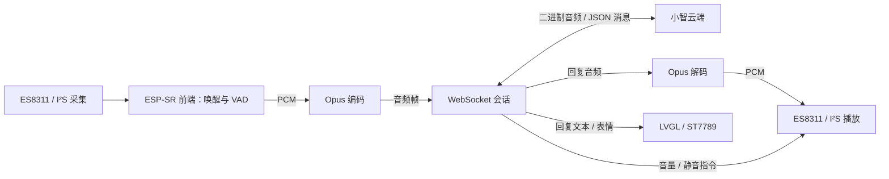

# 端云协同智能语音交互终端 · 小智

基于 ESP32-S3 与 ESP-IDF 的语音终端固件。本地负责唤醒检测、语音活动检测（VAD）、音频编解码和屏幕交互；小智云端负责识别、生成回复并返回合成语音。设备与云端通过同一条 WebSocket 连接交换控制消息和音频帧。本仓库包含终端固件，不包含云端模型或推理服务。

## 系统架构



### 一次对话如何流转

1. **联网与接入**：首次通过 BLE 配置 Wi-Fi，已有配置时直接以 STA 模式联网。设备请求激活接口，从返回的配置中取得 WebSocket 连接信息。
2. **唤醒与上行**：空闲时检测到唤醒词，终端连接 WebSocket，等待服务端回复 `hello` 后上报设备能力和唤醒事件。VAD 检测到人声后进入 `LISTENING`；发送任务仅在该状态下上传 Opus 帧，检测到静音时通知服务端停止监听。
3. **应答与呈现**：二进制帧进入解码队列并送往扬声器；JSON 文本帧单独分发。`tts.start`、`tts.stop` 对应进入和退出 `SPEAKING`；分句文本与表情字段分别驱动屏幕更新。播报期间再次唤醒时，终端向服务端发送中止和新一轮唤醒消息。

### 音频任务如何衔接

采集、编解码和网络收发并非一个同步循环。固件在 PSRAM 中创建三块各 **16 KiB** 的 FreeRTOS 环形缓冲区，按数据形态区分传递方式：

| 生产者 → 消费者 | 缓冲类型 | 用途 |
| --- | --- | --- |
| 语音前端 → Opus 编码任务 | 字节流（BYTEBUF） | 缓存 PCM，供编码器按输入帧大小取数 |
| 编码任务 → 网络发送任务 | 完整条目（NOSPLIT） | 保留每个压缩帧的边界，监听时按帧上传 |
| WebSocket 接收回调 → 解码任务 | 完整条目（NOSPLIT） | 回调交付下行音频帧，解码与播放由独立任务处理 |

音频数据走缓冲区，握手同步走事件组，对话阶段由 `IDLE / LISTENING / SPEAKING` 三个状态协调。对应实现见 [任务编排与消息分发](main/main.c) 和 [共享状态定义](main/common/xiaozhi_common.h)。

## 技术栈与实现位置

| 技术 | 在项目中的作用 | 源码入口 |
| --- | --- | --- |
| ESP-IDF 5.3.4、FreeRTOS、PSRAM | 初始化各模块；调度音频任务，分配跨任务缓冲区 | [应用入口](main/main.c) · [依赖锁定](dependencies.lock) |
| ES8311、I²C、I²S | I²C 配置音频芯片，I²S 传输采集与播放数据；支持音量与静音控制 | [音频设备](main/audio/xiaozhi_audio.c) |
| ESP-SR AFE、VAD | 在端侧检测唤醒词与语音活动，触发会话回调；不承担云端语音转文字 | [语音前端](main/audio/xiaozhi_sr.c) |
| Opus | 单声道、16 kHz、60 ms 帧；编码上行语音，解码云端回复 | [编码](main/audio/xiaozhi_audio_encoder.c) · [解码](main/audio/xiaozhi_audio_decoder.c) |
| BLE 配网、Wi-Fi STA、HTTP 客户端 | 配置入网、处理连接事件、请求设备激活与会话参数 | [联网](main/internet/xiaozhi_wifi.c) · [激活](main/internet/xiaozhi_active.c) |
| WebSocket、cJSON | 分流二进制音频帧与 JSON 控制帧；处理握手、播报状态及音量控制指令 | [会话传输](main/internet/xiaozhi_ws.c) · [消息处理](main/main.c) |
| ST7789、LVGL | 将云端返回的分句文本与表情映射到显示界面 | [屏幕驱动](main/display/xiaozhi_lcd.c) · [界面](main/display/xiaozhi_lvgl.c) |

## 构建与运行

使用 ESP-IDF **5.3.4** 的命令行环境，在仓库根目录执行：

```sh
idf.py build
idf.py -p PORT flash monitor
```

将 `PORT` 换成开发板串口。仓库的 [sdkconfig](sdkconfig) 已配置 ESP32-S3 与 PSRAM；更换开发板时，先核对音频和屏幕驱动中的引脚定义。模型分区见 [partitions.csv](partitions.csv)。完整对话还需要可用的 Wi-Fi 和云端设备激活；编译成功并不代表设备已完成云端接入。
